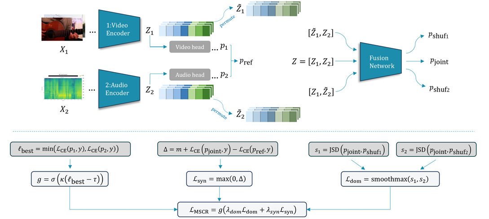

<div align="center">

# Multimodal Synergistic Competition Regularizer (MSCR)

Official implementation of the paper

### **_MSCR: Jointly Balancing Modality Utilization and Discovering Synergistic Information_**

#### Manuscript under review at NeurIPS 2026

</div>

<!-- Add the public paper URL, author list, affiliations, and repository license when available. -->

> **Documentation draft:** The method and results below follow the manuscript. Repository layout, installation instructions, and launch commands must be checked against the MSCR codebase before release. Items marked `TODO` require repository-specific information.

---

## TL;DR

**Balanced modality utilization does not automatically lead to effective cross-modal collaboration.** Building on the Multimodal Competition Regularizer (MCR), MSCR explicitly encourages the fusion network to discover predictive information beyond independent unimodal evidence. It combines an **anti-dominance objective**, a **margin-based synergy objective**, and a **proficiency-aware adaptive gate**. Across five benchmarks and nine evaluated settings, MSCR consistently improves over MCR and increases conditional recovery when unimodal predictions fail.

## Method

MCR addresses modality competition through game-theoretic regularization. MSCR builds on this foundation by explicitly encouraging synergistic gain at the fusion level.

The overall training objective is:

```math
\mathcal{L}_{\mathrm{total}}
=\mathcal{L}_{\mathrm{task}}
+\mathcal{L}_{\mathrm{MCR}}
+\mathcal{L}_{\mathrm{MSCR}},
\qquad
\mathcal{L}_{\mathrm{MSCR}}
=g\left(\lambda_{\mathrm{dom}}\mathcal{L}_{\mathrm{dom}}
+\lambda_{\mathrm{syn}}\mathcal{L}_{\mathrm{syn}}\right).
```

Here, the original MCR regularizer is retained:

```math
\mathcal{L}_{\mathrm{MCR}}
=\mathcal{L}_{\mathrm{MIPD}}+\mathcal{L}_{\mathrm{Con}}+\mathcal{L}_{\mathrm{CEB}}.
```

The following equations describe the two-modality classification setting. The experiments also include trimodal inputs and regression-style sentiment tasks.

### 1. Anti-Dominance Objective

We randomly permute each modality's latent representations along the batch dimension and measure the change in the fused prediction:

```math
p_{\mathrm{joint}}=f_c(z_1,z_2),\qquad
p_{\mathrm{shuf}_1}=f_c(\widetilde z_1,z_2),\qquad
p_{\mathrm{shuf}_2}=f_c(z_1,\widetilde z_2).
```

```math
s_i=\operatorname{JSD}(p_{\mathrm{joint}}\|p_{\mathrm{shuf}_i}),
\qquad
\mathcal{L}_{\mathrm{dom}}
=\frac{1}{\tau_{\mathrm{dom}}}
\log\left(e^{\tau_{\mathrm{dom}}s_1}+e^{\tau_{\mathrm{dom}}s_2}\right).
```

Minimizing the smooth maximum of these sensitivities discourages excessive dependence on a single modality. In contrast to MCR's modality-specific information objective, this additional objective targets dominance in the fusion network.

### 2. Synergy Objective

We construct an additive reference from the auxiliary unimodal predictions:

```math
p_{\mathrm{ref}}=\frac{1}{2}(p_1+p_2),\qquad
\ell_{\mathrm{joint}}=\mathcal{L}_{\mathrm{CE}}(p_{\mathrm{joint}},y),\qquad
\ell_{\mathrm{ref}}=\mathcal{L}_{\mathrm{CE}}(p_{\mathrm{ref}},y).
```

The synergy objective encourages the joint predictor to outperform this reference by a margin:

```math
\mathcal{L}_{\mathrm{syn}}
=\max\left(0,m+\ell_{\mathrm{joint}}-\ell_{\mathrm{ref}}\right).
```

While the anti-dominance objective reduces excessive unimodal influence, the synergy objective encourages gains beyond simply averaging independent predictions.

### 3. Proficiency-Aware Adaptive Gating

The gate adjusts regularization strength according to the best unimodal prediction on each sample:

```math
\ell_{\mathrm{best}}=\min(\ell_1,\ell_2),\qquad
g=\sigma\left(\kappa(\ell_{\mathrm{best}}-\tau)\right).
```

When unimodal evidence is insufficient, the gate increases the weight of both MSCR objectives. When a modality already predicts the target confidently, it reduces regularization. The gate is detached during optimization, as specified in the manuscript's training algorithm.

<div align="center">
  
</div>

MSCR is designed to regularize the fusion network without sending its additional regularization gradients into the modality-specific encoders. The standard task and MCR objectives remain part of training. MSCR is enabled within a specified activation interval after the initial training stage.

## Results

We evaluate MSCR on **five multimodal benchmarks** spanning emotion recognition, audio-visual event recognition, action recognition, and sentiment analysis. Experiments include ResNet, Conformer, and Transformer backbones with bimodal and trimodal inputs.

**V**: video; **A**: audio; **T**: text. All values below are reported in the manuscript; they are not new reproduction results.

### Main Results

The table below extracts the MCR and MSCR rows from Table 1. Values are accuracy (%) with mean ± standard deviation; MOSI and MOSEI use binary accuracy under the regression-style evaluation protocol. Gains are absolute percentage points (pp).

| Dataset | Backbone | Modalities | MCR | MSCR | Gain (pp) |
|---|---|---|---:|---:|---:|
| CREMA-D | ResNet | V-A | 74.5 ± 0.8 | **75.7 ± 1.1** | +1.2 |
| CREMA-D | Conformer | V-A | 85.1 ± 0.5 | **86.4 ± 0.9** | +1.3 |
| AVE | ResNet | V-A | 73.5 ± 0.0 | **74.5 ± 0.2** | +1.0 |
| AVE | Conformer | V-A | 87.4 ± 0.2 | **89.3 ± 0.3** | +1.9 |
| UCF | ResNet | V-A | 52.9 ± 2.4 | **54.4 ± 2.4** | +1.5 |
| CMU-MOSI | Transformer | V-T | 75.3 ± 0.7 | **76.8 ± 0.8** | +1.5 |
| CMU-MOSI | Transformer | V-A-T | 78.6 ± 0.2 | **80.1 ± 0.5** | +1.5 |
| CMU-MOSEI | Transformer | V-T | 80.8 ± 0.4 | **81.3 ± 0.5** | +0.5 |
| CMU-MOSEI | Transformer | V-A-T | 81.1 ± 0.4 | **81.8 ± 0.6** | +0.7 |

MSCR improves over MCR in every listed setting. This comparison does not imply that MSCR outperforms every other baseline in every setting; see the full comparison in the paper.

### Synergy Analysis via Conditional Recovery

We examine whether the fused model recovers correct predictions when unimodal predictors fail. For two modalities, the conditional recovery rate is:

```math
\operatorname{Recovery}
=\Pr\left(\widehat y_{\mathrm{joint}}=y
\mid\widehat y_1\ne y,\widehat y_2\ne y\right).
```

Table 2 of the manuscript reports the following conditional recovery rates:

| Dataset | Backbone | Modalities | MCR | MSCR |
|---|---|---|---:|---:|
| CREMA-D | ResNet | V-A | 10.13% | **18.35%** |
| CREMA-D | Conformer | V-A | 5.92% | **9.98%** |
| AVE | ResNet | V-A | 5.50% | **7.07%** |
| AVE | Conformer | V-A | 6.93% | **12.95%** |
| UCF | ResNet | V-A | 10.28% | **15.45%** |
| CMU-MOSI | Transformer | V-T | 4.85% | **34.35%** |
| CMU-MOSI | Transformer | V-A-T | 10.87% | **17.44%** |
| CMU-MOSEI | Transformer | V-T | 7.12% | **12.50%** |
| CMU-MOSEI | Transformer | V-A-T | 6.71% | **13.69%** |

These results provide behavioral evidence of improved cross-modal collaboration. The additive reference and conditional recovery analysis are practical proxies, rather than exact estimates of PID synergy.

<div align="center">
  
</div>

### Transformer-Based Fusion

MSCR also improves conditional recovery when the fusion module is replaced with a Transformer (Table 3). Overall test accuracy is reported separately in Appendix D, Table 6.

| Dataset | Unimodal backbone | MCR recovery | MSCR recovery | MCR accuracy | MSCR accuracy |
|---|---|---:|---:|---:|---:|
| CREMA-D | ResNet | 15.66% | **21.39%** | 74.88% | **75.02%** |
| CREMA-D | Conformer | 11.82% | **25.66%** | 82.12% | **82.35%** |
| AVE | ResNet | 11.11% | **15.13%** | 74.05% | **74.12%** |
| UCF | ResNet | 16.41% | **22.63%** | 53.11% | **53.45%** |

### Ablation Study

Both objectives contribute to performance. The following representative results are from Table 4; values are accuracy (%).

| Anti-dominance | Synergy | CREMA-D (Conformer) | AVE (Conformer) | MOSI (V-T) |
|:---:|:---:|---:|---:|---:|
| Off | Off | 85.1 ± 0.5 | 87.4 ± 0.2 | 75.3 ± 0.7 |
| On | Off | 85.9 ± 0.6 | 88.8 ± 0.4 | 75.9 ± 0.7 |
| Off | On | 86.2 ± 0.5 | 88.3 ± 0.2 | 76.1 ± 0.9 |
| On | On | **86.4 ± 0.9** | **89.3 ± 0.3** | **76.8 ± 0.8** |

## Repository Structure

**TODO: Verify this proposed layout against the MSCR repository.** It follows the organization of the supplied MCR README and does not assert that these code files already exist.

```text
MSCR/
├── agents/             # Training and evaluation pipeline
│   └── helpers/        # Evaluator, loader, trainer, and validator
├── configs/            # Dataset/backbone configurations and MSCR settings
├── datasets/           # Dataset loaders
├── experiments/        # Experiment resources, if retained from MCR
├── figs/               # Method and result figures
├── models/             # Encoders, fusion models, and regularizers
├── posthoc/            # Post-hoc evaluation and conditional recovery analysis
├── utils/              # Utility functions
├── run.sh              # Experiment launcher, if retained from MCR
├── train.py            # Training entry point, if retained from MCR
├── requirements.txt    # Verified dependencies
└── README.md
```

## Installation

**TODO:** Add the repository URL, tested Python/PyTorch/CUDA versions, and dependency installation command from the actual environment. The manuscript reports experiments on a single **NVIDIA RTX 4090 with 24 GB memory**; this is the reported experimental setup, not a verified minimum requirement.

## Path Setup

**TODO: Confirm whether MSCR retains MCR's path-resolution mechanism before using this section.** The upstream README uses these variables:

| Variable | Purpose | Upstream default |
|---|---|---|
| `PROJECT_DEFAULT_DIR` | Repository root | Set explicitly |
| `PROJECT_CHECKPOINTS_DIR` | Checkpoint directory | `PROJECT_DEFAULT_DIR/checkpoints` |
| `PROJECT_DATA_DIR` | Dataset directory | `PROJECT_DEFAULT_DIR/data` |

If the same mechanism is retained, configure a local `.project_paths.sh`:

```bash
#!/usr/bin/env bash
export PROJECT_DEFAULT_DIR="/path/to/MSCR"
export PROJECT_CHECKPOINTS_DIR="/path/to/checkpoints_root"
export PROJECT_DATA_DIR="/path/to/data_root"
```

In the supplied MCR README, `run.sh` loads this file automatically, and configuration prefixes `project_data_directory/` and `project_checkpoints_directory/` are resolved to the corresponding paths. Verify that behavior in MSCR before relying on it.

## Training and Evaluation

### Experimental Protocol

Following Appendix A of the manuscript:

- Use the same data splits, modality-specific encoders, fusion backbones, optimizer settings, learning-rate schedules, batch sizes, and training epochs as MCR.
- Select the best checkpoint using the validation set, then evaluate on the test set.
- Report mean and standard deviation across **three folds** for CREMA-D and UCF, and **three independent random seeds** for AVE, MOSI, and MOSEI.
- Enable MSCR after the initial training stage and only within the configured activation interval.

### MSCR Hyperparameters

The settings below reproduce Table 5 of the manuscript. Symbols describe the method; they are not confirmed command-line argument names.

| Dataset | Backbone | Modalities | λ_dom | λ_syn | m | τ_dom | κ | τ |
|---|---|---|---:|---:|---:|---:|---:|---:|
| CREMA-D | ResNet | V-A | 0.02 | 0.03 | 0.05 | 10.0 | 5.0 | 1.5 |
| CREMA-D | Conformer | V-A | 0.05 | 0.03 | 0.05 | 10.0 | 5.0 | 1.2 |
| AVE | ResNet | V-A | 0.02 | 0.03 | 0.05 | 10.0 | 5.0 | 1.5 |
| AVE | Conformer | V-A | 0.05 | 0.03 | 0.05 | 10.0 | 5.0 | 1.2 |
| UCF | ResNet | V-A | 0.02 | 0.03 | 0.05 | 10.0 | 5.0 | 1.5 |
| CMU-MOSI | Transformer | V-T | 0.05 | 0.03 | 0.04 | 10.0 | 5.0 | 1.2 |
| CMU-MOSI | Transformer | V-A-T | 0.05 | 0.03 | 0.04 | 10.0 | 5.0 | 1.2 |
| CMU-MOSEI | Transformer | V-T | 0.05 | 0.03 | 0.04 | 10.0 | 5.0 | 1.2 |
| CMU-MOSEI | Transformer | V-A-T | 0.05 | 0.03 | 0.04 | 10.0 | 5.0 | 1.2 |

### Launching Experiments

**TODO:** Replace the template below with a tested command. It assumes the upstream `train.py` interface is retained; configuration paths and MSCR options must be confirmed from the code.

```text
python train.py \
  --config <PATH_TO_MSCR_EXPERIMENT_CONFIG> \
  --default_config <PATH_TO_DATASET_DEFAULT_CONFIG> \
  --fold <FOLD_INDEX>
```

Before release, provide the exact training and checkpoint-evaluation commands, the mapping from MSCR hyperparameters to configuration keys, the activation interval, and the fold/seed settings. Also document the command used to compute conditional recovery, including the failure condition used for trimodal inputs.

## Datasets

Data preparation follows the MCR evaluation protocol described in the manuscript.

| Dataset | Evaluated modalities | Task | Source |
|---|---|---|---|
| **CREMA-D** | Video + Audio | Emotion recognition | [CREMA-D](https://github.com/CheyneyComputerScience/CREMA-D) |
| **AVE** | Video + Audio | Audio-visual event recognition | [AVE](https://github.com/ysricuan/AVE-ECCV18) |
| **UCF101** | Video + Audio | Action recognition; 51-category audio-visual subset | [UCF101](https://www.crcv.ucf.edu/data/UCF101.php) |
| **CMU-MOSI** | Video + Text; Video + Audio + Text | Sentiment analysis | [CMU Multimodal SDK](https://github.com/A2Zadeh/CMU-MultimodalSDK) |
| **CMU-MOSEI** | Video + Text; Video + Audio + Text | Sentiment analysis | [CMU Multimodal SDK](https://github.com/A2Zadeh/CMU-MultimodalSDK) |

CREMA-D uses actor-disjoint splits. MOSI and MOSEI use the aligned data versions provided through MultiBench. See Appendix B of the manuscript for preprocessing and backbone details.

**TODO:** Add the exact download/preprocessing steps and expected on-disk layout used by the repository's dataset loaders.

## Acknowledgments

This work builds on **Multimodal Competition Regularizer (MCR)**:

**Balancing Multimodal Training Through Game-Theoretic Regularization**, by Konstantinos Kontras, Thomas Strypsteen, Christos Chatzichristos, Paul Pu Liang, Matthew B. Blaschko, and Maarten De Vos.

We thank the MCR authors for their research and open-source implementation. MSCR retains the MCR regularization framework and adds fusion-level anti-dominance, explicit synergy enhancement, and proficiency-aware adaptive gating.

[MCR repository](https://github.com/kkontras/MCR) · [MCR paper](https://arxiv.org/abs/2411.07335)

## Contact

For questions and feedback, please open an issue in this repository.

<!-- TODO: Add the corresponding author's public email address when appropriate. -->

## Citation

**MSCR:** Citation metadata will be added with the public manuscript. The current manuscript is under review at NeurIPS 2026.

<!-- TODO: Add a BibTeX entry with the confirmed authors and public manuscript URL. Do not label the paper as accepted while it is under review. -->

If your work uses the underlying MCR method or implementation, please also cite:

```bibtex
@inproceedings{kontras2025MCR,
  title={Balancing Multimodal Training Through Game-Theoretic Regularization},
  author={Konstantinos Kontras and Thomas Strypsteen and Christos Chatzichristos and Paul Pu Liang and Matthew B. Blaschko and Maarten De Vos},
  booktitle={The Thirty-ninth Annual Conference on Neural Information Processing Systems},
  year={2025},
  url={https://openreview.net/forum?id=auiURbhoYx}
}
```

## License

**TODO:** Specify the repository's license and retain the applicable notices for reused code. The MIT badge in the supplied MCR README does not by itself establish the license of this MSCR repository.
